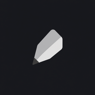

<div align="center">



# Grafit

**Az iskolád. A te stílusod.**

Magyar nyelvű, natív Android KRÉTA-kliens, személyre szabható Material 3 felülettel.

[](https://github.com/VKornel1031/Grafit-/actions/workflows/android.yml)
[](app/build.gradle.kts)
[](LICENSE.txt)

[Letöltés](https://github.com/VKornel1031/Grafit-/releases) · [Használati útmutató](docs/USAGE.md) · [Hibajelentés](https://github.com/VKornel1031/Grafit-/issues) · [Közreműködés](CONTRIBUTING.md)

</div>

## Mi az a Grafit?

A Grafit az órarendedet, jegyeidet, hiányzásaidat és iskolai teendőidet hozza egy közös, testre szabható felületre. Kotlin és Jetpack Compose alapokon készül. A KRÉTA-integráció, a navigáció és a mozgások a [Firka](https://github.com/QwIT-Development/firka) munkájára épülnek, natív Android-adaptációval.

A Grafit **független alkalmazás**, nem a KRÉTA hivatalos kliense, és nem áll kapcsolatban a KRÉTA üzemeltetőjével.

## Funkciók

| Terület | Mit kínál? |
| --- | --- |
| Kezdőlap | Következő tanóra, napi órarend, legutóbbi jegyek és hírek; jelzés, ha nincs tanítás vagy véget ért a nap |
| Órarend | Heti és napi navigáció, tanterem, tanár és tananyag; a további hetek betöltése igény szerint |
| Jegyek | Tantárgyi és éves átlag, részletes értékelések, technikumi ösztöndíjbecslés |
| Hiányzások | Igazolt, igazolatlan és igazolásra váró mulasztások, késések |
| Teendők | Házi feladatok, bejelentett dolgozatok, faliújság és tanári feljegyzések |
| Értesítések | Választható háttérellenőrzés, saját üzenetsablonok és állítható gyengébbjegy-határ |
| Élő tanóra | Alapból monokróm visszaszámlálás a tanóra végéig; testre szabható szöveg és megjelenés |
| Személyre szabás | Material You, saját paletta és jegyszínek, CSS-témaváltozók, kapszula eszköztárak, kártyák és betűk |
| Helyi profil | Saját megjelenített név és profilkép, fiókonként elkülönítve |
| Mozgás | Animált navigáció, órarendváltás és jegyfelfedés; választható 60 / 120 Hz a megfelelő kijelzőkön |
| Bemutató mód | Kipróbálható felület kitalált adatokkal, KRÉTA-fiók nélkül |

## Telepítés

A közzétett, aláírt telepítők a [GitHub Releases](https://github.com/VKornel1031/Grafit-/releases) oldalon találhatók. Az aktuális forrásverzió **1.1.1**; változásai a [kiadási jegyzetben](releases/1.1.1.md) olvashatók.

1. Válassz egy közzétett kiadást, és töltsd le az APK-mellékletét.
2. Nyisd meg a fájlt a telefonodon. Szükség esetén engedélyezd a telepítést a használt böngésző vagy fájlkezelő számára.
3. Jelentkezz be a KRÉTA saját oldalán, vagy válaszd a bemutató módot.

Az általános kiadáshoz **Android 8.0+** szükséges. A korai fejlesztői változathoz készült, `key-migration` nevű csomagok **Android 9.0+** rendszert igényelnek. A Material You dinamikus színei Android 12-től, a kiemelt élő állapotsávjelzés az azt támogató Android 16+ rendszereken érhetők el.

A hivatalos, azonos aláírással készült kiadásokat a meglévő alkalmazásra telepítsd az adatok megtartásához. Eltérő fejlesztői aláírásnál olvasd el az [aláírási útmutatót](docs/SIGNING_MIGRATION.md). A GitHub Actions debug csomagjai fejlesztői tesztelésre valók, és nem helyettesítik az aláírt kiadásokat.

## Szinkronizálás és értesítések

A teljes szinkron indításkor, bejelentkezés után és kézi frissítéskor fut. A további órarendi hetek megnyitáskor töltődnek le, ha még nincsenek helyben mentve. Sikertelen kérés esetén a korábbi adatok megmaradnak.

Az értesítéseket a **Beállítások → Értesítések** menüben kapcsolhatod be. Külön választható az új jegy, a gyengébb jegy, a házi feladat és a bejelentett dolgozat; a címük és szövegük is módosítható. A háttérellenőrzést az Android körülbelül 15 percenként ütemezi: ez nem a hivatalos KRÉTA push szolgáltatása, és az energiatakarékosság késleltetheti.

Az élő tanórai értesítés a helyi órarend alapján számol vissza. A számlálót az Android frissíti; a kiemelt állapotsávjelzés elérhetőségét és megjelenését a rendszer szabályozza. [Részletek és korlátok](docs/NOTIFICATIONS.md).

## Adatvédelem

A Grafit közvetlenül a KRÉTA szolgáltatásaival kommunikál. Nincs saját fiókrendszere vagy iskolai adatokat gyűjtő Grafit-szervere. A bejelentkezési tokenek, az iskolai gyorsítótár és a helyi profil Android Keystore-kulccsal titkosítva tárolódnak; az automatikus felhőmentés ki van kapcsolva. A megjelenési és értesítési beállítások az alkalmazás saját helyi tárában maradnak.

A frissítéskereső a GitHub nyilvános kiadási adatait kéri le. Az alkalmazás nem tartalmaz analitikai vagy reklám-SDK-t. [Adatkezelési tájékoztató](PRIVACY.md).

## Fejlesztés

Szükséges: **JDK 17 vagy 21**, **Android SDK 35**, **Build Tools 35.0.0**. A Gradle wrappert a projekt tartalmazza.

```bash
./gradlew :app:assembleDebug :app:testDebugUnitTest :app:lintDebug
```

A teszt-APK: `app/build/outputs/apk/debug/app-debug.apk`. Az éles kiadásokhoz külön, privát aláírókulcs szükséges; ez nincs a repositoryban. Saját kulccsal aláírt csomag nem telepíthető a hivatalos kiadás frissítéseként.

A CI fordítással, JVM-tesztekkel és linttel ellenőriz. Az eszközteszteket lefordítja; tényleges futtatásuk külön Android-eszközt igényel. Az értesítések háttérbeli időzítését, az élő állapotsávjelzést és a 120 Hz-es működést fizikai eszközön is ellenőrizni kell.

## Dokumentáció és közreműködés

- [Használat, témák és ösztöndíjbecslés](docs/USAGE.md)
- [Értesítések és élő tanóra](docs/NOTIFICATIONS.md)
- [Közreműködés és fejlesztői ellenőrzések](CONTRIBUTING.md)
- [Kiadás és aláírás](docs/RELEASING.md)
- [Adatkezelés](PRIVACY.md) · [Biztonsági hibák bejelentése](SECURITY.md)

Hibát vagy ötletet a [GitHub Issues](https://github.com/VKornel1031/Grafit-/issues) oldalon jelezhetsz. Jelenleg egy KRÉTA-fiók használható egyszerre. A házi feladatok beadása, a csatolmányok kezelése és az e-ügyintézési üzenetek nem támogatottak.

## Köszönet és licenc

Köszönet a **QwIT Developmentnek és a Firka közreműködőinek**. Az átvett működés és a módosítások részletei az [ATTRIBUTION.md](ATTRIBUTION.md) fájlban találhatók.

A projekt **[CC BY-NC-SA 4.0](LICENSE.txt)** licenc alatt érhető el: névfeltüntetéssel, nem kereskedelmi célra és azonos licenc alatti továbbadással használható. Ez forrásként hozzáférhető projekt, a licenc kereskedelmi korlátozást tartalmaz. A KRÉTA és E-KRÉTA megnevezések a megfelelő jogosultakhoz tartoznak.

<div align="center">

**Made By Kodi ❤️**

</div>
